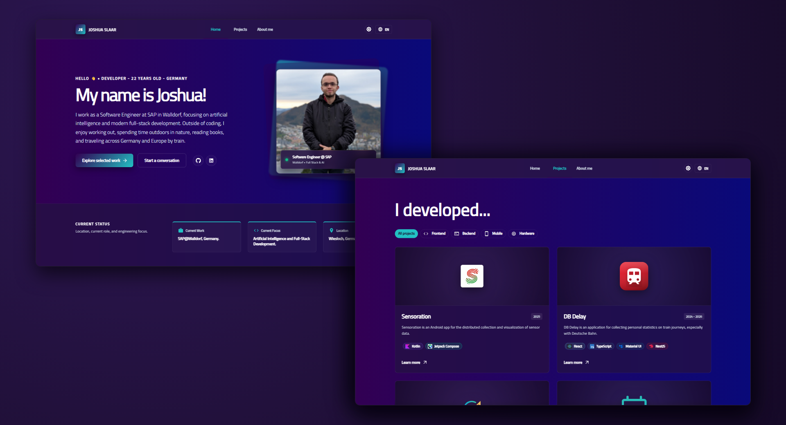

# My Portfolio 

This repository contains my personal portfolio at [joshua.slaar.de](https://joshua.slaar.de). It brings together selected software projects, technical skills, professional experience, and experiments I achieved over the years. The portfolio is built with React, TypeScript, and Material UI.

	

## Built With

- [React 19](https://react.dev/)
- [TypeScript](https://www.typescriptlang.org/)
- [Vite](https://vite.dev/)
- [Material UI](https://mui.com/)
- [React Router](https://reactrouter.com/)
- [Yarn](https://yarnpkg.com/)

## Available Routes

- `/` or `/home` — personal introduction, quick facts, and experience highlights
- `/projects` — project gallery with category filtering
- `/projects/:id` — deep-dive project details, hardware photos, and tech stack
- `/me` — about me, milestones timeline, and skills breakdown
- `/privacy` — privacy policy
- `/ui5` — secret OpenUI5 showcase easter egg

## Feedback

Questions, ideas, and feedback are welcome. You can reach me at [info@joshua.slaar.de](mailto:info@joshua.slaar.de).
